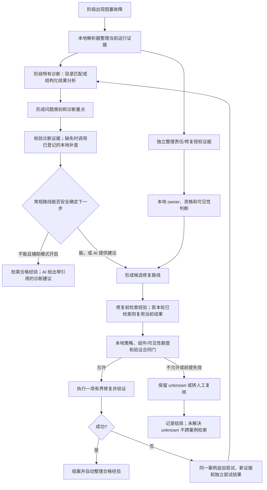

# 后续项目推进计划：证据驱动诊断与经验库

> 版本：讨论稿 v0.3<br>
> 日期：2026-10-15<br>
> 状态：供共同讨论和修改；P2 已完成，P3 实施计划待评审，后续阶段仍须逐项评审授权<br>
> 工作名称：证据驱动诊断辅助与经验库；最终名称待定<br>
> 原始审计基线：服务器 `/data/AgRefactor`，分支 `backup/server-current-20261013`，提交 `5721150f401f2bdec93518b5ec95c9261da3d3d0`；当前状态已纳入 P2 完成结果<br>
> 本次更新：纳入 2026-10-14 服务器代码审计、P2 执行状态，以及用户确认的经验检索/注入、额度、旧组件复用边界和新代码职责命名原则。

## 文档目的

本稿在 v0.2 基础上，进一步整理了目录与诊断/授权证据的关系、案例内多次尝试的经验资格、Testbench Public/Hidden 分账，以及 CSIM/COSIM 的阶段特有资格判断。v0.1、v0.2 原稿保留不改；本稿仍是供讨论的大纲。P2 已按单独评审的实施计划完成；P3 及后续阶段仍须逐阶段评审授权，本稿本身不改变现有正式诊断目录或权威路线文档。

## 当前执行状态（2026-10-15）

| 阶段 | 状态 | 结果与剩余工作 |
|---|---|---|
| P1 | 代码覆盖审计完成；代表性端到端基线仍待补齐 | 两份过时测试已修正；这两项测试修改纳入本次代码备份提交。端到端基线和 CSIM fallback 归责合同仍按下文跟踪。 |
| P2 | 已完成 | 已实现 Case/Attempt、证据检查、责任与修复资格快照、ExperienceRecord 数据合同，以及 `RecoveryLedger` 组件额度预留/提交接口。按 P2 的详细实施计划，本阶段不接入运行时修复路由、不实现案例持久化或经验生成；这些仍由后续阶段处理。2026-10-15 对 7 个定向测试模块复跑，87 项通过，`git diff --check` 通过。 |
| P3 | 具体实施计划已形成，待评审；尚未获实施授权 | [P3 实施计划：案例记录与自动经验整理](proposals/P3_CASE_CAPTURE_AND_EXPERIENCE_DERIVATION_PLAN.md)。它以 P2 合同为基础，计划接入案例记录与结案后的自动经验整理；评审认可前不开始 P3 实现。 |

P2 的详细实施计划收窄了本稿阶段大纲中的范围：当前完成的是可测试的数据合同与额度接口，不是完整运行时接线。额度接口暂未被生产修复入口调用，符合 P2 边界；接入 Candidate、Testbench 和 Stub 修复入口及统一额度账本仍属于后续阶段。

本次将已完成的[服务器代码审计](服务器代码审计_证据驱动诊断与经验库_v0.3_2026-10-14.md)纳入代码基线。已核实的调用顺序不再列作待讨论选择；审计尚不能决定的实现合同继续保留为未决项。

服务器备份锚点已建立在上述分支和提交。服务器上未跟踪的运行产物、重复目录和 `.orig/.rej` 文件不属于这份计划的实现范围。运行服务器命令时，须在同一个 shell 中先执行 `source /data/agrefactorpp_env.sh`，再进入 `/data/AgRefactor`。

## 一、已形成的设计共识

1. **当前运行证据优先。** 当前阶段日志、编译单元、源码位置、运行身份、报告和验证结果决定本次诊断。历史经验只提供辅助方向，不得覆盖或改写当前证据。
2. **`unknown` 是有效结论，不是流程终点。** 它表示责任或根因尚不能确认。系统可以继续使用本地证据、已登记采集器和 AI 辅助分析；AI 不得把原始 `unknown` 猜测性改成确定事实。
3. **AI 不执行任意服务器命令。** 模型可以引用已有证据，并建议一个已登记的检查 ID；检查由本地代码按固定范围、权限和输出限制执行。模型不能生成并运行任意 shell 命令，也不能直接读写服务器目录。
4. **区分诊断证据与责任/授权证据。** 两者可能来自同一份日志、报告或源码映射，但回答不同问题：诊断证据用于识别问题类型和缩小排查范围；责任/授权证据用于判断修改哪个组件、是否有资格修复以及是否通过权限和预算门。目录命中可以让问题诊断更有针对性，但不能降低责任确认和修复授权的最低要求。当前代码在逻辑上已有这些职责的不同组件，但尚未形成完整的“目录匹配→诊断计划→检查→路由”闭环。
4.1. **区分已确认 owner 与诊断候选。** 当前代码通常返回一个 `FeedbackOwner` 判断；证据不足时返回 `UNKNOWN`，并不是所有路径都会同时产生标准化的“候选责任列表”。新设计允许在 `owner=unknown` 时附带候选责任或责任线索，但候选只用于诊断和经验检索，不代表当前责任，也不能授予修复权限。只有本次运行的本地证据确认 owner 后，才可进入对应组件的修复路线。
5. **修复前检索，失败后更新再检索。** AI 辅助诊断模式开启时，每次修复尝试前都检索适用经验；一次尝试失败并产生新证据后，下一次修复前基于更新状态重新检索。向模型提供“经验摘要＋真实关键改动片段”，检索时同阶段优先、允许受条件限制的跨阶段参考；注入数量和动态上下文预算已有首轮建议，具体见第三节。没有足够适用的经验时允许检索结果为空，不为填满名额注入低相关经验；若仍需 AI 分析，AI 可只依据当前证据工作。当前证据和正式规则决定责任、合格动作与验证合同；经验可帮助在已允许动作中优先选择历史上有效的实现方式、提醒具体失败写法。经验不能新增动作、改变 owner、授予修复权限、放宽预算或替换验证合同。
6. **AI 分析和经验检索属于同一个辅助模式。** 开启该模式表示每次修复前检索经验；当常规证据与确定性路线仍不能安全选定下一步时，AI 才基于当前证据和合格经验协助归因或建议已登记检查。目录命中不自动关闭检索；AI 也不因检索到经验而自动取得修复权限。
7. **一个阻塞故障对应一个案例，尝试结果不等于案例结论。** 一次故障中的多次修复和复验都是同一案例内的尝试。案例结局和单次尝试结局分开记录；一次 Candidate 修改未通过，不代表 Candidate 修复方法整体失败。正常无阻塞错误的运行默认不形成诊断案例；结束时仍为 `unknown` 的字段原样保留。
8. **案例结案后自动整理经验，规则晋升仍由人审核。** 案例记录和结案后的经验整理由同一开关控制；整理过程必须可重复执行而不产生重复经验。经验能否检索由明确的结局与证据条件限定。经验提炼成正式目录规则仍须人工审核。
9. **不设置自动生命周期。** 不做自动衰减、过期、晋升、降级或淘汰。通过追加记录、幂等整理和明确的审核记录管理案例、经验和规则。
10. **修复额度按组件计数，Testbench 再按可见性分账。** 不论由目录专用路径、通用 Candidate 路径或 AI 辅助路径触发，只要修改的是同一组件，就消耗该组件额度。Testbench 额度另分 Public 与 Hidden 两本账；同一可见性内的正式修复和生成资格修正路径统一扣账。Hidden 额度本身不授予权限，正式 Hidden 评测反馈后的修复仍受禁止边界约束。不同组件另行计数，并受全局动作上限约束。AI 不获得额外次数。
11. **保留 Hidden 边界。** 正式 Hidden 评测后的修复仍禁止；正式 Hidden 评测内容、失败标签、逐项结果及可反推出隐藏用例的信息，不进入诊断案例、经验检索或 Candidate 模型上下文。Hidden Testbench 生成器目前可在冻结前使用自己生成的代码和生成期资格反馈，这与正式评测反馈后修复不同；其信息不得因此进入跨案例经验或 Candidate 修复。新模块接入时须明确两者的投影合同。
12. **优先复用现有组件。** 先复用阶段解析器、目录、owner 证据、验证合同、repair policy、ledger、prompt 入口和测试工具；只补足真实缺口，不另建平行修复流水线。新代码、接口和配置按职责命名，不采用 R3/R5 这类历史阶段代号；这些代号只用于准确指称旧实现或旧实验。

## 二、当前代码基线

以下来自已完成的服务器调用链审计。代码事实与计划设计分开记录；具体文件位置、触发条件和审计范围见审计报告。P1 的代码覆盖审计已完成，代表性端到端运行基线仍需补齐。

| 能力 | 当前代码事实 | 对计划的影响 |
|---|---|---|
| 正式诊断目录 | CSYNTH 直接匹配，预检及 CSIM compile/link 分类间接复用目录。目录提供类别和元数据；router 未消费 `diagnostic_id`、`evidence_requirements`、`allowed_actions` 来执行专项检查。COSIM 配置有规则，但未发现生产 matcher 调用。 | 首个专项证据试点已确定为 `HLS 214-298`，复用 libclang 顶层类型合同检查。完整证据支持专项诊断重点；缺失或矛盾时回退基础诊断。目录不判定 owner，也不降低修复授权门槛；其他规则逐条依据真实案例评估。 |
| CSIM/COSIM | 两阶段均有 Public unknown-owner reference qualification。CSIM 针对部分 runtime failure；COSIM 另要求工具与 COSIM 已启动、非 timeout，并排除接口合同 mismatch 等情形。Original 隔离验证通过后增加 `public_reference_qualified` 信号，owner 不因此改为 Candidate。 | 三阶段共用辅助框架，各自保留证据、触发条件和验证合同；qualification 是资格路径，与目录命中无关。 |
| Owner 判断 | `owner_evidence.py` 可辅助判断 candidate、testbench、original/configuration 等来源；Public/Hidden 是可见性边界，不是 owner 类型。Stub 有测试生成/资格流程自己的处理，但公共 `FeedbackOwner` 没有 `STUB`。 | 不把目录命中当作 owner 结论。Stub 暂按局部生成流程管理，后续给独立组件额度，不为此强行并入主 owner 路由。 |
| CSIM 编译失败分支 | `tb_compile_failed` fallback 只调用 `infer_failure_owner(diagnostics)`，缺少映射因而返回 unknown；native Vitis 的 compiler failure 优先路径另有 build manifest、源码 hash 和 source-role 核验。 | 已确认 fallback 行为，不等于整个 CSIM 编译归责缺失。是否应补映射仍需确认该 fallback 的输入来源和预期合同，不能先把保守 unknown 改为确定责任。 |
| Candidate 修复 | 当前有跨阶段聚合的 Candidate 修复额度和通用 Candidate 修复编排，但没有“owner 仍为 unknown 就普遍兜底修复”的路线。 | Candidate 通用修复、目录专用策略和 AI 辅助归因是不同概念；AI 不能替 unknown-owner 路线授予权限。 |
| Public CSYNTH bounded trial | 先解析/分类 blocking feedback；满足 unknown-owner、物理执行完成、非零退出、非 timeout 等条件后执行 Original 隔离资格验证；通过后记录 bounded authority 和 repair eligibility，再交 router。 | 用户已决定保留。它与普通 Candidate 修复是不同授权条件，复用同一修复引擎；目录命中与否不触发该资格路径。 |
| Testbench 正式修复 | `RecoveryPolicy` 允许正式 Testbench 修复的范围目前包括 Preflight、Public CSIM 和 Public COSIM；正式 Hidden 恢复被拒绝，`hidden_repairs=0`。正式 Testbench 修复通过 ledger reserve。 | 当前按阶段键计数，未形成 Public/Hidden 两本 Testbench 额度账本，也未与生成资格修正统一。目标是同一可见性下跨入口共享额度。 |
| Testbench 生成资格修正 | `tb_optimizer.py` 按 trajectory 局部事件和 `max_repairs` 计数，未接入 RecoveryLedger。Hidden 生成器在冻结前使用自身代码及 Original/interface/compile/coverage 资格反馈。 | 两条入口已盘点，但账本尚未统一。Public/Hidden 生成资格修正各扣相应 Testbench 额度；新案例/经验模块不得接收 Hidden 生成内容，正式 Hidden 评测后的修复仍禁止。 |
| Stub 修复 | Stub 的生成/重生成由 Testbench 生成资格流程局部管理，例如 `regenerate_stub`；它不是当前公共 `FeedbackOwner` 枚举中的主流程 owner。 | 先保留其附属处理方式；统一组件额度时将 Stub 与 Testbench 分开计数，避免 Stub 改动挤占 Testbench 额度。 |
| 旧记忆组件 | 普通产品默认关闭旧 R5 arm；旧实验可注入运行前绑定的 memory snippets。未发现每次失败后按新证据动态检索的产品入口，也没有新 Case/Attempt 与结案自动整理闭环。R3 gate 类型仍被 R4 integration 使用，R4 repair episode 仍参与现有记录流程。 | **直接复用：** Candidate prompt 的 `approved_memory_snippets` 传递入口，仅作为新检索结果的接入点；它本身不负责检索、筛选或 token 预算。**仅借鉴：** 旧 ledger 的追加记录思路、R4 episode 的来源/验证记录思路、R3 gate 的准入约束思路；新系统不沿用这些旧数据结构作为 Case/Attempt 或经验合同。**不进入新系统：** 自动 lifecycle、A0–A6 流程、运行前绑定 snapshot 的旧 payload 流程及旧 R5 产品接线。保留现有 R4/R5 依赖和历史实验记录；是否及如何清理旧实现另做引用/测试/配置/数据盘点并估算成本，不在本次改造中顺手删除。 |
| 本地证据补查 | 已有阶段 parser、artifact/report reader、源码角色与编译单元证据工具；未发现统一的检查 ID registry/dispatcher。 | `HLS 214-298` 试点范围已确认：仅用当前运行的日志/执行/工件身份、已验证的源码 provenance 与 compile unit，并让 libclang 按本次运行的顶层函数、源码和编译上下文检查接口关联类型；不扫描整个工作目录/项目，不读取其他运行记录或 Hidden 评测内容。 |
| 目标测试基线 | 初次审计记录 137 项中有 5 failures、3 errors。随后更新两份过时测试，原失败的 6 个测试方法（其中一个有 3 个属性子测试）通过；本次明确列出的 13 个模块共 118 项通过。 | 两次测试集合数量不同，不声称完整重跑了原 137 项或全项目全绿。测试修正未改生产实现；后续运行基线须按冻结清单记录。 |

主要核实位置：

- `/data/AgRefactor/agrefactor/recovery/policy.py`：Hidden 正式恢复拒绝、Testbench 正式修复阶段限制及预算键。
- `/data/AgRefactor/agrefactor/runtime/candidate_repair_integration.py`：正式 Testbench repair ledger reserve。
- `/data/AgRefactor/flow/tools/tb_optimizer.py`：Testbench/Stub 生成资格与 trajectory 修正路径。
- `/data/AgRefactor/agrefactor/evidence/feedback.py`、`/data/AgRefactor/agrefactor/evaluation/owner_evidence.py`：公共 owner 类型与局部角色辅助函数。
- `/data/AgRefactor/agrefactor/runtime/csim_stage.py`、`/data/AgRefactor/agrefactor/evaluation/testbench_preflight.py`：CSIM 编译失败 owner 调用与缺少映射时的行为。
- `/data/AgRefactor/agrefactor/evaluation/csynth_diagnostics.py`、`/data/AgRefactor/agrefactor/evaluation/staged_preflight.py`：CSYNTH 直接匹配和 compile/link 间接匹配。

## 三、目标运行流程



### 目录在流程中的职责

- 诊断证据与责任/授权证据可以共用原始日志、报告或源码映射，但需分别表达：前者决定问题类别和排查重点；后者决定修改对象、资格和权限。当前实现有相关组件，但尚未将两类证据合同完整连成可执行计划。
- 命中规则的目标是缩小问题诊断的搜索范围，指出已有解析器/检查器可核验的重点证据；未命中通常需要更广泛的通用诊断。命中与否不改变 owner、修复资格和授权所需的最低证据门槛。哪些规则确实能减少诊断检查项，须逐条用当前目录、parser 和案例验证，不能只根据字段推断。
- 可复用的闭环构造是：目录 matcher 输出规则 ID；轻量适配层将规则 ID 映射到已登记的检查器、证据要求、候选策略提示和验证合同；本地现有 owner/policy/budget/validator 再作最终判断。没有可靠映射的条目只提供类别/线索，不凭空生成新检查器。先以 CSYNTH 规则试点。
- 只有目录里实际存在、且代码已调用的匹配逻辑才影响当前路线。CSYNTH 直接匹配与 compile/link 预检间接匹配不能外推为 CSIM/COSIM 运行错误也按目录匹配。
- 目录不能单独判定 Candidate/Testbench/Stub 责任，不能把 `unknown` 改成 Candidate，也不能授予修复资格。
- 缺少必要证据时只调用已有且本地登记的采集器；补查仍缺失则退回基础诊断或人工复核。证据与规则矛盾时不使用该规则的修复策略。
- 未命中规则时继续基础证据分析；若当前证据和确定性合同不能选出安全下一步，才由 AI 辅助归因。没有通用 Candidate 权限的情况，不因 AI 提出假设而获得修复权。

### 经验检索与 AI 辅助诊断的开关关系

计划保留两个开关组：

| 开关组 | 开启后的行为 | 关闭后的行为 |
|---|---|---|
| 案例与经验整理 | 记录非 Hidden 阻塞故障案例；结案后按结果自动整理经验。整理可幂等重跑，不产生同一案例的重复经验。 | 不新增案例或经验；已有正式目录与既有运行能力不变。 |
| AI 辅助诊断 | **每次修复尝试前检索经验**；常规路径无法安全确定责任/下一步时，AI 读取当前 allowlist 证据及适用经验，返回有引用的建议。 | 不检索经验、不调用 AI 诊断；使用当前确定性流程。 |

两个开关组默认均关闭，只有显式启用后才记录/整理案例，或在修复前检索经验并调用 AI 辅助诊断。AI 辅助诊断开关与修复前经验检索绑定，不单独关闭其中的检索行为。

AI 辅助诊断开启不意味着每次都让 AI 决定动作。检索与注入分别设计：检索负责选出哪些经验；注入负责如何把经验提供给 AI 或修复执行器。用户已确认向模型提供“经验摘要＋真实关键改动片段”，下面记录其生成与使用方式。确定性路由仍由本地规则和证据选择责任、合格动作及验证合同；如果该路线调用模型生成代码，提示词可以收到与当前 owner 和允许动作兼容的经验片段，以帮助选择具体实现写法。若执行器本身没有实现选择空间，经验只作提示或审计信息。确定性路由选择器不读取任意经验文本，只接收允许的结构化信息；经验不能扩大动作集合或改变授权。具体评分、阈值、候选数量、正负经验呈现模板及 tokenizer 接口仍待评审；首轮注入条数和 token 预算已定为第三节的候选上限。

### 已确认：经验摘要与真实关键改动片段

本节记录已认可的设计方向，具体接口与接线范围仍须在实施前评审。第一版优先复用真实源码工件和本地标准差异工具，不先建设复杂的 AST 分析或因果定位系统。

1. **记录真实版本。** 每次尝试保存或稳定引用修复前后的源码、内容 hash、case/attempt 身份、修改组件和验证结果。运行期对象拥有源码，不等于持久化的安全 JSON 已完整保存源码；实现前应核验实际工件并只补缺口。
2. **本地生成差异。** 可用 Python `difflib` 计算带必要上下文的逐次 diff，片段必须来自实际输入和输出源码。AI 可以辅助选择修改块或解释修改意图，但本地程序负责提取和核对，不能用模型重写的代码冒充真实片段。
3. **同时保留逐次与累计差异。** 对 V0→V1→V2→V3、最后验证通过的案例，保留各次 diff，并计算最初故障版本 V0 到最终通过版本 V3 的累计 diff。不能仅用 V2→V3 代表整个修复；前两次验证失败也不证明其中所有改动无效。跨组件修改须保留对应组件、尝试及验证的关联，不能混成一份单组件补丁。
4. **依据证据选择修改块。** 根据报错位置、相关函数或接口、实际改动和关联声明选择一个或多个完整修改块，保留必要上下文。关联数组声明、类型或其他修改时一起呈现，避免截取一行造成误解。若无法判断哪些修改独立有效，明确记录“该修改组合通过了指定验证”，不把单个片段声称为已证实根因或独立有效的修复。
5. **完整差异留档，检索后选择展示内容。** 完整 diff 留在案例工件；经验保存可追溯的片段或引用。每次检索后再依据当前问题选择相关片段，经验内容包含适用条件、摘要、真实 before/after diff、验证范围、来源和适用限制。长度不足时省略低相关的完整修改块或改用摘要，不截断必要的关联修改。
6. **验证结论限于实际范围。** 阶段验证通过不等于整个最终流水线通过。记录实际执行的检查、对应源码版本及结果；案例结案和经验准入继续遵循第四节的结局规则。
7. **作为当前修复参考。** 当前运行证据、当前源码和正式规则是判断依据；历史片段仅供参考。模型须先对照当前证据、源码和修复合同判断历史经验是否适用，再决定如何借鉴或调整，不得盲目复制历史 diff。当前证据和正式规则确定组件与允许动作，经验可以在这些边界内提示更有依据的实现方式、避免机械重复具体失败写法；负向经验不能单独禁止动作。Candidate 继续输出完整替换代码，历史 diff 不改变其输出合同。确定性路由器不执行任意历史 diff，也不读取任意经验文本。

已核查的复用点：Candidate 的 `CandidateRepairAttempt` 已有 `input_candidate`、`proposal` 和 `validation_result`，修复循环可追踪累计迭代；`RepairArtifactWriter` 可用于保存修复工件与 hash manifest，但具体 payload 须核验。Testbench 的尝试对象没有明确的前后源码字段，可优先复用逐次预检目录的源码工件，再补稳定引用和前后关联。Candidate 提示词已有 `approved_memory_snippets` 入口；Testbench 使用相同的 `SharedLayeredPromptBuilder`，经验入口还需补最小接线。当前尚未实现本节的关键片段抽取与动态注入闭环。

### 已确认：同阶段优先、受条件限制地跨阶段参考

优先检索同阶段经验，同时允许满足明确适用条件的跨阶段经验作为参考。这里的“同阶段优先”不是无条件压过跨阶段经验，而是先核验责任方向和适用条件，再比较相关程度；在责任方向兼容的经验中，相关程度相近时同阶段优先，跨阶段经验若在错误特征、工具/编译环境、源码条件和修改组件等方面明显更贴近当前问题，可以排在相关性较弱的同阶段经验前面。阶段不同不作为一律排除的理由，也不能仅凭报错文字相似就跨阶段选入。

- 跨阶段适用性需核对与该经验有关的错误特征、工具/编译环境、源码条件、修改组件和关键证据，具体字段及兼容性条件在详细设计中确定，不能把尚未确认的条件当成已实现的检查。
- 例如，CSIM 编译阶段通过调整类型声明解决的案例，在 CSYNTH 出现同类编译问题时，可以在适用条件得到支持后作为参考；不能据此把 CSIM 运行时经验普遍当成综合修复经验。
- 保留并展示历史阶段、实际验证范围和跨阶段使用的限制。历史上只验证过 CSIM，就只记录 CSIM 验证通过；当前阶段是否有效仍由当前验证合同判断。
- owner 相同但阶段不同的经验，可以在当前阶段作为直接修复参考；owner 不同但内容属于通用诊断方法的经验，可以作为诊断参考；owner 不同且包含组件专用改动的经验，不直接注入当前组件的修复提示。跨阶段经验必须保留历史验证阶段和当前适用限制，不改变本地责任判断或修复授权。
- 同阶段优先与相关性如何具体计算、何时扩大检索范围、适用条件缺失或矛盾时如何处理，以及当前 owner 为 unknown 时如何选经验，继续列为待讨论细节。

### 已确认：owner 为 unknown 时的经验使用

当本次运行的本地证据不足以确认责任组件时，仍可检索带有历史 owner 的经验，用于比较类似条件、解释可能方向和选择下一项已登记检查。经验必须明确标注历史 owner，不能把历史 owner 改写成当前 owner，也不能直接授予 Candidate、Testbench 或其他组件的修复权限。只有当前证据随后确认责任组件，历史经验中的对应改动片段才可进入该组件的修复提示；如果始终是 `unknown`，经验只作为诊断参考，案例保留原始 `unknown`。

### 已确认：当前案例查询输入

每次修复前由本地代码根据当前运行状态生成临时的 `CurrentCaseQuery`；它不是经验记录，当前案例也不会在修复前被提前转换成经验。一次尝试失败并产生新证据后，下一次修复前重新生成查询输入。

查询输入包含两组信息：

- **结构化字段**：阶段与可见性、错误类别/错误码及规范化特征、当前 owner 状态和责任线索、已确认/缺失/矛盾的证据、工具/编译环境/运行模式、报错文件/函数/接口/编译单元，以及本案例已经尝试的动作和验证结果。
- **受限上下文**：相关日志片段、报错位置附近的源码窗口、关联类型/接口/声明和当前结构化诊断摘要。不上传整个项目源码，也不把未授权的 Hidden 内容放入查询。

查询处理采用以下顺序：

1. 可见性限制、明确矛盾和验证合同完全不兼容属于硬过滤条件。
2. 责任方向、错误特征、关键证据、源码上下文和历史验证强度用于剩余经验的相关性排序；当前 owner 为 `unknown` 时，历史 owner 只作诊断参考。
3. 在责任方向兼容的经验中，同阶段优先；明显更相关的跨阶段经验可以排在相关性较弱的同阶段经验前面。
4. 检索结果保留命中原因、历史阶段/owner、验证范围和适用限制，便于审计为什么选中或弃用某条经验。

第一版优先采用结构化字段筛选加有限日志/源码上下文比较，不预先引入整个仓库的语义搜索。查询构造和硬过滤由本地代码完成，AI 只消费检索后的受限结果。

### 已确认：利用本案例尝试历史，但不机械禁止重试

将本案例已尝试的动作、对应修改和验证结果提供给检索及修复模型，用于提示哪些改动已试过、哪些结果仍未通过，并减少原样重复无进展修改。尝试历史不是硬过滤条件：不自动禁止同一修复方向，也不阻止模型根据新证据补全或改进先前不完整的修改。重试仍须通过当前 owner/资格、修复策略、组件额度和验证合同；不增加“重复就停止”的启发式规则，停止仍由额度耗尽或既有安全前提失效等条件决定。

### 已确认：有限源码上下文的解析基础

第一版复用项目已有的 Vitis `libclang` ctypes 接口，不手写 C++ 语法解析器。用真实 diff 找到报错或修改范围后，由 `agrefactor/cpp_interface.py` 提取所属函数/声明、源码起止位置、规范化类型、接口参数、符号和必要的函数体节点；`flow/tools/result_mapping.py` 中已有稳定的 libclang cursor/源码映射使用方式可参考。最终保留原始源码片段和有限上下文，静态解析结果只作为检索特征，不替代实际编译、综合或运行验证。

当前服务器环境没有 `tree_sitter`/`tree_sitter_cpp` Python 包；Tree-sitter 暂不作为第一版依赖，未来仅可在需要容错语法解析时评估为备用工具。`pycparser` 主要面向 C，不作为当前 C++/HLS 项目的解析器。libclang 解析失败时保留原始 diff、日志和可用证据并返回未知，不凭静态结果强行推断责任或根因。

### 已确认：检索实现顺序

第一版先实现可解释的检索基线：结构化字段筛选后，比较错误词项、源码符号/类型和有限上下文的重合，再结合责任方向、阶段、证据和历史验证强度排序。每条结果记录命中字段和弃用原因。等有留出集后，再评估候选集合内的语义向量检索、阈值和权重；不先让 embedding 成为唯一的检索依据。

### 已确认：正向与负向经验分区返回

检索结果分为两个区域：

- **正向经验**：相似条件下实际采用过、并由本地验证确认有效的修改方式，附真实改动片段、验证范围和适用限制。
- **负向经验**：只有具体动作、执行条件和失败结果能够明确关联，且来源案例最终已经解决时，才整理为窄范围的“该动作在相似条件下失败过”提醒。

负向经验不能写成“Candidate 修复无效”或“Testbench 修复无效”，也不能直接否定所有候选路线。一个案例中前几次修改失败、后续累积修改成功时，前几次仍是同一 Case 内的中间 Attempt；它们不会自动成为 owner 或修复类别的负面结论。最终仍未解决的案例只保留 Case/Attempt 记录，不跨案例生成负向经验。

向 AI 注入时正向和负向经验分区显示，并分别写明其作用：正向经验用于参考可能的修改方式，负向经验用于避免在相似条件下机械重复具体失败动作。两类经验都不能改变当前 owner、修复资格或预算。

### 已确认：检索候选集与提示词注入集分离

检索阶段可以保留较大的候选集合，并记录每条候选的命中字段、排序分数、淘汰原因和适用限制；实际注入 AI 提示词时只选择少量最相关经验，正向与负向经验分区呈现。第一版不把所有候选经验直接塞入上下文，避免低相关经验干扰当前证据。首轮注入数量上限为正向最多 3 条、负向最多 2 条；实际数量还受动态 token 预算约束。未注入的候选仍保留在检索审计日志中。

没有候选通过适用性过滤或排序阈值时，允许返回空结果；不为填满注入上限而降低标准或塞入低相关经验。日志应区分“没有候选”“候选被硬过滤”“候选未达到排序阈值”和“候选因条数/token 预算未注入”等情况，并记录可审计的原因。经验为空不阻塞正常诊断或修复流程；若常规路径仍无法安全确定下一步，AI 可以只分析当前运行证据，不带历史经验。

注入的历史经验须明确标为参考数据，不是本次任务指令或事实来源；提示词要求模型先核对其与当前证据、源码及规则的适用性，再借鉴或调整。历史经验与当前证据或规则不一致时，以当前证据和规则为准，不照搬历史修改。

经验区块预算不等于整个提示词的长度上限。设所用模型的总上下文窗口为 `C`，为修复输出预留 `R_out`，当前系统指令、当前证据和源码等非经验提示词实际占用 `P_base`，另留安全余量 `R_safe`，则首轮经验 token 预算为：

```text
B_exp = min(floor(0.15 * C), max(0, C - R_out - P_base - R_safe))
```

每次发送前用该模型对应的 tokenizer 统计实际渲染后的提示词。按检索排序，在 3 条正向/2 条负向数量上限及 `B_exp` 长度上限内加入完整经验；某条经验的摘要和必要 diff 片段放不下时，整条跳过并记录原因，不截断 diff。空间不足时允许注入少于上限或不注入经验，修复继续依据当前证据和现有流程。首轮 15% 是经验区块的最大预算比例，不是必须填满的目标，之后用留出集评估调整。

### 已确认：经验对已选定修复路线的作用

当前证据和正式规则决定“修哪个组件、哪些动作有资格执行、采用什么验证合同”；检索经验可以在该动作集合内减少实现试错：正向经验优先提示相似条件下验证有效的写法，负向经验提醒具体写法在相似条件下失败过，但不能单独禁止它。如果规则只允许一个动作，经验仍可帮助该动作的代码实现选择；若实现完全固定、没有选择空间，经验只作为提示或审计记录。经验与当前规则冲突时，以当前证据和本地规则为准。经验不得增加动作、改变 owner、授予修复权限、放宽预算或替换验证合同。

## 四、案例与经验的形成规则

### 案例边界

- 一个阻塞故障建立一个 case；后续修复、失败、复验和责任状态变化都作为该 case 的尝试或事件追加。
- 正常无故障运行不建立诊断 case。所有有权限持久化的非 Hidden 阻塞故障都可留档，包括最终修复成功、最终修复失败、未获授权、证据无效和结案时仍为 `unknown`。
- 案例保留原始证据引用和 unknown，不要求 AI 在事后补造根因。已修复不代表每一个尝试都有效。
- Hidden 正式评测数据不能形成可供检索的案例或经验。任何与 Hidden 资格路径有关的记录也必须先确认只含允许的非敏感元数据；逐项隐藏结果、用例内容和可反推内容不持久化到经验库。

### 自动整理为经验

案例开关开启时，在 case 结束后自动整理经验；这是案例采集的一部分，不再增加一个独立的“案例转经验”开关。每条经验保存来源 case/attempt、适用阶段、错误特征、责任与关键证据、结果和限制条件，并使用稳定身份保证重跑幂等。

- 已验证解决的案例可以形成正向经验并参与检索；优先同阶段，跨阶段按第三节的适用条件核验。错误特征、责任相关证据和关键条件须足够相关。当前 owner 为 unknown 时可检索历史 owner 经验作为诊断参考，但不得据此改变当前 owner 或授予权限；owner 不同且包含组件专用改动时，不直接注入当前修复提示。
- 单次尝试失败不自动形成负向经验，更不代表“Candidate 修复失败”。例如同一 Candidate 连续迭代三次后通过，案例结局是该故障由 Candidate 修复解决，前两次保留为中间尝试。
- 只有当某个具体动作/改动、其执行条件和验证结果可明确关联，且失败不是单纯未完成的中间步骤时，才考虑整理窄范围负向经验，例如“在相似条件下，动作 X 未通过指定验证”。无法把失败归因到具体动作时只保留原始尝试记录，不跨案例检索。
- 结案后的成功案例可用于整理正向经验；一次未通过尝试可以作为成功案例中的过程信息，但不能被粗化成对整个 owner、修复类别或策略的负面结论。
- 整个 case 结案时仍未解决、根因未知的，保留案例但不作为跨案例检索经验。某次尝试的失败记录仍留在原 case；不能仅因有失败日志就自动推断它对未来有用。
- 修复结果成功、失败或不确定必须由本地验证和 outcome 证据确定；模型文本不能单独把尝试晋升为已验证经验。

经验自动整理与经验进入正式诊断目录是两步。前者按上面的条件自动完成；后者必须经人工审核，确保候选规则有匹配条件、必需证据、适用责任、允许动作、矛盾/缺失时的 fallback 和验证合同。新旧规则进入正式目录后使用同一运行格式，来源和审核记录仍分别保留。

## 五、责任、修复路线与预算

### 责任和路线

责任由本地结构化证据推断。诊断目录提供问题类别和排查焦点；AI 可以在普通路线未能确定时辅助解释证据，但不能裁定 owner。诊断检查与责任/授权检查可复用同一原始证据，但应在结果中分别表达。修复前必须由本地代码重新检查 owner、可见性、repair eligibility、对应组件和可见性额度、验证合同及其他策略门。

阶段特有判断与修复路径要分别描述和评测：

1. **目录专用诊断/修复。** 目录只在现有匹配点影响诊断；具体修复权限仍通过本地 owner 和 policy。
2. **通用 Candidate 修复。** 当前已有 Candidate 修复引擎，但适用性受 owner 与策略约束；它不是 `unknown` owner 的通用兜底，也不是 Public CSYNTH bounded trial。
3. **Public CSYNTH bounded trial。** 已核实顺序为：解析/分类 blocking feedback→检查 unknown-owner 与执行前提→Original 隔离资格验证→记录 `public_csynth_bounded_trial` 和 repair eligibility→router/policy/额度检查→现有 Candidate 修复引擎。目录是否命中不在资格触发条件内。保留该合同，不把它改成目录未命中后的普遍兜底。
4. **CSIM/COSIM Public reference qualification。** 两者均在阶段结果表明符合各自 unknown-owner runtime 合同时，先做 Original 隔离验证，通过后增加 `public_reference_qualified`，再交既有路由和策略门。CSIM 不以该路径处理编译失败；COSIM 另排除 timeout、接口合同 mismatch 等情形。这是阶段特有的资格检查，不是目录匹配，也不直接证明责任属于 Candidate。详细触发条件见审计报告第 2 节。

AI 辅助诊断是帮助归因/选下一步的公共能力，不是绕过权限门的另一种修复引擎。三个阶段可以共用诊断和 AI 辅助框架，但各自保留不同的证据、资格判断和修复合同。只有本地策略确认某条现存修复路线有资格，AI 建议才可能进入该路线；实际收益需按阶段评测。

### 按组件共享修复额度

计数基本维度是**被修改的组件**，不是触发修复的阶段或系统名称。Candidate 当前跨阶段聚合额度作为参考；Testbench 额外按可见性分为 Public Testbench 与 Hidden Testbench 两个额度账本，并在同一可见性内统一正式修复和生成资格修正路径；Stub 单独计数。一次操作若实际修改多个组件，应分别消耗对应组件额度，并受全局动作硬上限约束。额度不授予修复权限。

Testbench 额度统一盘点必须覆盖两条已存在的路径。当前 `optimize_tb_public()` / `gen_tb_with_coverage()` 的 Public trajectory 数 `M` 默认是 1；`make_golden_hidden_tb()` 的 Hidden generation `M` 默认是 3。因此，“默认 trajectory=1”只适用于 Public 路径，不适用于 Hidden generation。

当前代码中的数值基线（这是现状审计，不代表新账本数值已定）：`repair_budget.py` 中 Candidate 和 Testbench 的默认修复次数均为 3；`RecoveryLimits` 中 Candidate 聚合上限为 3、正式 Testbench 的各阶段上限分别为 3、全局 recovery action 上限为 5，Hidden 正式修复为 0。`tb_optimizer.run_trajectory()` 的 `max_repairs` 默认也是 3，因此按已确认的线性规则，Testbench 生成资格修正的单 trajectory 基线可从 3 起算。产品默认 profile 是 Lightweight；`source_bootstrap._build_generation_settings()` 在该模式下将 Public/Hidden trajectory 数和初始轮数都设为 1，测试也断言此结果。trajectory 数为 1 不等于修复次数为 1：该 trajectory 的 `max_repairs` 仍为 3，失败时可进入有界修正轮次。配置中的 Public/Hidden trajectory 默认数 3 用于 Coverage-enhanced 配置，不代表 Lightweight 的有效运行数。当前没有单独的 Stub 修复次数配置：`repair_testbench_stub` 等组合动作受 Testbench 请求上限约束；单独 `regenerate_stub` 主要受 trajectory 的 `K` 轮次间接限制。Stub 的新组件账本因此需要明确一个自己的基准，不能称为复用现有 Stub 上限。

| Testbench 路径 | 当前涉及范围 | 统一额度要求 | Hidden 边界 |
|---|---|---|---|
| 正式 Testbench 修复循环 | Preflight、Public CSIM、Public COSIM 的 Testbench 修复，通过 recovery policy 和 ledger | 正式 Public 修改扣 Public Testbench 额度；同一账本跨正式修复入口共享 | 正式 Hidden 评测反馈后的修复仍禁止。 |
| Testbench 生成资格修正 | `tb_optimizer` 中为生成的 Testbench trajectory 修正资格/耗尽问题，现状按 trajectory 有局部 `max_repairs` | Public 生成资格修正扣 Public Testbench 额度；允许的 Hidden 资格修正扣 Hidden Testbench 额度；与同一可见性下的正式修复共用账本 | 已确认 Hidden 生成器使用自身代码和生成期资格反馈；这些内容只留在生成器范围内，不进入 Candidate 修复或跨案例经验。正式 Hidden 评测反馈仍不得用于修复。 |

Stub 的重生成若修改 Stub，消耗 Stub 独立额度，不占 Testbench 额度。**计次语义已确认：** 修复请求通过策略/权限检查并实际派发给修复执行后，立即预留目标组件额度；即使没有文件差异或验证失败，仍计为一次尝试。请求在派发前被拒绝、或仅进行诊断而未派发修改，不扣组件额度。**trajectory 与额度的关系已确认：** 同一 Testbench 生成任务中的多条 trajectory 共用任务级、按组件和可见性区分的总额度；提高该任务的 `M` 时，按对应生成路径的单条 trajectory 基准额度线性提高任务总额度（`M × 单条基准额度`），全局逻辑动作上限也按 `M` 线性提高。所有 trajectories 共用扩大的额度池，不给每条 trajectory 单独复制完整额度。该 `M` 只影响使用它的 Testbench 生成任务，不自动扩大独立 Candidate 修复循环的额度。**案例账本范围已确认：** 同一个案例跨阶段、跨修复入口共享该案例的组件额度；恢复同一个未结案案例时沿用已消耗额度；从头新建案例（即使输入相同）则建立新账本，不与其他独立案例共享额度。**并发扣额已确认：** 并行请求需原子预留全局逻辑动作名额及该动作涉及的全部组件额度，避免并发超发；多组件名额整体预留，任一不足则不派发。预留后若请求未成功派发给执行器，释放名额；成功派发后转为已消耗额度。**多组件动作的计数已确认：** 一次逻辑修复动作若修改多个组件，全局修复动作上限计一次，每个被修改的组件分别扣一次组件额度。单条 trajectory 的具体基准值仍需在实施前的额度合同中明确。

额度耗尽时以未解决状态结案，不因 AI 归因额外发放尝试；若安全/验证前提失效则提前转人工。除此之外，不加“相同错误重复出现”或“进展不明显”等启发式提前停止条件。额度尚有余量且对应组件仍有合法路线时，可以继续尝试。

## 六、本地证据补查建议

优先直接使用本次运行已经生成的日志、结构化诊断、报告、编译单元、源码路径/角色映射、运行状态和工件清单。只有关键字段缺失时，才由本地 dispatcher 调用预登记的只读采集器补查。

采集器设计建议：

- 每个检查有固定 ID、允许阶段、工作目录根、允许文件类型/相对路径、只读操作、输出格式和失败状态；AI 只能引用这些 ID。
- 先精确读已知日志、报告和源文件位置的有限上下文；需要扩大范围时逐级授权到编译单元或明确子目录，不做无边界全仓扫描或源代码整包上传。
- 对输出设置字节数/行数上限、超时和敏感字段过滤；保存证据引用、采集时间和工具版本，以便复核。
- 采集范围由公共运行身份和阶段策略限制。Hidden 评测内容不进入 AI 或经验库；Hidden 修复权限不因补查扩大。
- 未登记的命令、网络访问、软件安装、写文件和删除操作不作为 AI 可建议执行的检查。

审计已确认这些现有工具可复用，但统一 registry/dispatcher 尚不存在。下一步详细设计须从真实调用点选出首批检查 ID，并逐项列出输入、已有实现、输出、范围和失败语义；先评审清单，再实现接口。

### 已确认：HLS 214-298 专项证据试点

- 规则 `hls_214_298_struct_pointer_argument`（`HLS 214-298`）作为第一个专项证据样例，复用 `extract_top_type_contract` 检查当前 Candidate 顶层函数及接口关联类型。该 libclang 能力已用于 `staged_preflight.py` 的类型合同检查。
- 检查输入仅来自当前 CSYNTH 运行：当前诊断日志、执行结果和工件身份；经校验的源码 provenance 与 compile unit；以及本次运行对应的 Candidate 顶层函数、源码、编译参数和 include 路径。libclang 只解析该翻译单元实际包含的依赖，不递归扫描整个项目或工作目录。
- 检查结果分三态：完整类型合同确认对应顶层参数包含指针成员时，确认专项诊断重点；源码来源、运行身份或 libclang 结果不完整时为缺失；完整类型合同与诊断不符时为矛盾。缺失或矛盾均回退基础证据分析，不执行该规则的专项策略；必要时 AI 仅分析当前可用证据。
- 补查不得读取无关源码、其他运行记录或 Hidden 评测内容。来源无法验证时不得扩大扫描范围来猜测。
- 专项结果可缩小诊断重点并为既有修复路线提供更具体的类型/字段依据；owner、repair eligibility、额度和验证合同仍由现有本地证据与策略门判断，目录命中不授予权限。

## 七、实施阶段与可核验完成条件

以下阶段仅是候选执行顺序；本稿获用户认可前，不构成代码修改授权。阶段顺序不等于具体施工方案，也不代表所有阶段已获实施授权。

**逐阶段计划与评审约定：** 每次开始一个 P 阶段前，先提交该阶段的具体实施计划，列出目标与完成条件、涉及的代码/文档范围、复用组件与预期改动、执行步骤、依赖和风险、验证命令/验收标准，以及适用时的回滚办法。用户审阅后继续讨论和修订；只有双方把本阶段范围与验收条件讨论清楚、用户认可该计划后，才执行该阶段。阶段完成后先验证并报告结果，再准备下一阶段的具体计划；不得把对一个阶段计划的认可默认为后续阶段也已授权。

### P0：确认本稿并统一项目路线

汇总仍待确认的设计决策，并在本稿获认可后统一 `ROADMAP.md`、`R5_IMPLEMENTATION_PROGRESS.md` 和 `V2_3_COMPLETION_EXECUTION_PLAN.md` 中与新方案冲突的旧 lifecycle 计划。旧组件的复用/借鉴/不进入新系统边界已确认；权威路线更新时保留历史名称用于说明旧代码，不把 R3/R5 用作新功能名称。

**完成条件：** 一份用户认可的设计文档和一个权威执行路线；任何仍未确认的选择都有明确标注，不以旧实验方案替代新决策。

### P1：真实代码覆盖审计与可复现基线

**状态：代码覆盖审计已完成；过时目标测试已修正；代表性端到端运行基线待补齐。** 审计报告覆盖 v0.1 以来列出的 15 项审计点，已追踪目录、owner/资格、Candidate/Testbench/Stub 修复入口与账本、Hidden 生成边界、旧 R3/R5 接线和本地补查缺口。代码事实以该报告为底稿，不再重复整轮审计。每条具体规则的检查清单与新接口是下一阶段设计任务。

2026-10-14 测试修正只改两份测试文件：ABI 前置校验 mock 顺序、真实 Candidate 声明、当前 round 字段、冻结类型上下文，以及资格验证插桩后的原文保留断言。原失败的 6 个测试方法已通过；本次 13 个目标模块共 118 项通过，`git diff --check` 通过。这两份测试修改与 P2 实现一并纳入本次代码备份提交。

后续补齐固定输入、配置和日志的代表性运行，覆盖成功、失败、unknown、无资格、额度耗尽及 Candidate 多次迭代后成功；不将目标单元测试通过等同于端到端基线完成。CSIM fallback 的预期归责合同仍需单项分析。

**完成条件：** 每条修复循环可从入口追到 permission/budget/validation；能列出每次修改实际消耗哪个组件额度；所有服务器复跑命令在同 shell 先 source 环境文件。

### P2：统一最小数据合同和预算合同

先交付详细设计供用户评审，再实现合同。复用 `DiagnosticEvent`、episode ledger、owner/visibility、现有预算与验证类型，定义 case、attempt、诊断证据、责任/授权证据、证据引用、案例结局、尝试结局、experience、来源版本和审核状态。定义证据三态（满足/缺失/矛盾）、首批采集器清单和 Hidden 投影规则。额度键按组件设计；Testbench 另有 Public 与 Hidden 两个账本，并明确两条修复路径如何扣账。每项设计须给出真实复用点、输入输出示例、最小接线范围和验证方法，不一次改完整流水线。

**完成条件：** 纯本地测试覆盖 case/attempt 关联、unknown 保留、尝试失败与案例结局分离、幂等去重、多组件/可见性额度计数、正式 Hidden 评测修复拒绝及证据三态；不依赖 LLM 运行。

### P3：接入案例记录与自动经验整理

只在符合持久化约束的阻塞故障结案后整理经验；案例处理中可追加尝试，整理任务可安全重跑。案例结局与单次尝试结果分开，单次修复未通过不自动整理为负向经验；只有可归因到具体动作且由验证证据支持的失败才考虑成为窄范围负向经验。按第三节保存或引用真实源码、逐次及累计差异，并关联验证范围，形成摘要与可追溯改动片段。未解决 unknown 只留在案例中。经验自动整理不自动写入正式分类目录。

**完成条件：** 目录修复成功、通用修复成功、Candidate 多次迭代后成功、某次改动明确无效、权限拒绝、unknown 和无效证据等用例均有正确 case/outcome/attempt 结果；同一 case 重跑不会重复生成经验；正式 Hidden 评测内容无法进入库。

### P4：接入修复前检索和 AI 辅助诊断

实现第二个开关组：每次修复前按本次最新证据检索适用经验；常规路径未能安全确定时才调用 AI 分析。每次失败把新证据和具体尝试写入同一 case，并在下一次尝试前重新检索。检索算法与注入细节分别设计并评测；模型提示采用已确认的“经验摘要＋真实关键改动片段”。当本地规则已选定路线时，经验只影响允许动作内的实现写法/优先级，不改变资格与合同。先 shadow 记录候选经验、AI 建议、实际注入内容与结果，再评测具体模板、数量和长度限制。

**完成条件：** 检索发生在所有合法修复路径之前；低相似经验不会强行套用；可以审计“检索到了什么、实际注入了什么”；AI 输出只含证据引用、经验引用、归因假设及已登记检查 ID；没有调用 shell 或改变权限的接口。

### P5：目录诊断焦点与本地采集器接入

盘点每条目录规则是否有可靠、可重复核验的专项诊断证据；有则通过轻量适配层连接现有 parser/检查器，无则仅作为问题类别/线索。明确诊断证据三态及缺失/矛盾/未命中的 fallback，同时让 owner/授权证据继续走现有判断。先在 CSYNTH 打通“匹配→检查计划→结果→现有路由”闭环；保持 CSIM/COSIM 使用阶段结构化证据，不强制做运行错误文本目录匹配。

**完成条件：** 至少一条真实规则让目录命中实际选择已存在的诊断检查；目录命中不会降低 owner/权限门槛；必需证据不满足或矛盾时不套用规则修复；未命中仍能沿较广的基础诊断和 AI 辅助路线继续。

### P6：统一修复预算，重点覆盖 Testbench 两条路径

在 P1 审计结果上把实际修改接入组件额度账本。轻量模式的单条 trajectory 基准额度已确认：Candidate 3；Testbench Public 3、Hidden 3；Stub Public 3、Hidden 3。Public 与 Hidden 各有一条 Stub trajectory，共两条；两条 Testbench 可见性额度也分别计数。无 Testbench/Stub 组合动作时，全局逻辑恢复动作上限为 15（3+3+3+3+3）。Testbench 与 Stub 若由同一个逻辑修复动作共同修改，全局只计一次，但分别扣两个组件额度，因此实际全局动作数只会更低。增加 trajectory 数时，相关组件额度和全局逻辑动作上限按单条 trajectory 基准线性增加。

Testbench 正式 Public 修复扣 Public 额度；生成资格修正按 Public 或 Hidden 分别扣账，并在同一可见性下与相应路径共享。正式 Hidden 评测反馈后修复保持禁止；允许的 Hidden 资格修正也不得读取或泄露正式 Hidden 反馈。Candidate 保持跨阶段额度合同；Stub 使用独立组件额度。AI、目录路径与通用路径不得各有额外配额。以上是新设计的轻量目标基线，不代表当前实现参数。当前 `RecoveryLedger` 的全局上限仍为 5，且 `tb_optimizer` 的生成修复还使用局部计数；统一账本必须让这些修复请求也原子预留全局动作及所有目标组件额度，派发前拒绝不扣额，成功派发后计次，避免局部路径绕过上限。

**完成条件：** 跨阶段/跨入口测试证明 Public Testbench 路径共同扣 Public 额度、允许的 Hidden 资格路径扣 Hidden 额度，Public/Hidden Stub 分别扣账；正式 Hidden 评测反馈修复仍拒绝；正式 Hidden 评测内容不进入 case、experience 或诊断/修复 prompt，生成期内容不越出其生成器范围；单组件和 Testbench+Stub 组合动作均按合同原子扣账，所有账本耗尽和全局动作上限均可审计。

### P7：小范围试运行和因果评测

先做 Public、固定阶段和预算下的 shadow/pilot，再扩展阶段。CSYNTH、CSIM、COSIM 分别报告结果；比较当前基线、只用当前证据的 AI、增加经验检索和目录专项检查等条件。Hidden 相关测试只验证隔离、资格合同和额度账本，不以正式 Hidden 评测反馈驱动修复。按时间或源码家族隔离案例，禁止近重复泄漏。

**完成条件：** 报告归因、unknown 校准、检查有效性、经验检索质量、修复率/回归率、权限误授/误拒、各组件额度消耗、人工复核比例、成本和阶段差异；所有结果能由冻结配置、输入清单和日志复现。

## 八、实验与论文评估建议

实验中保留既有种子诊断目录，来源如实标记为现有人工/项目规则；不要把它写成新记忆机制自动学习所得。若需要冷启动对照，在隔离副本中清空问题专用规则实例，保留类别结构、证据合同、owner 判断、安全策略和验证器。线上目录与共用安全合同不做“恢复出厂设置”。

建议至少比较：

| 条件 | 目录 | 当前证据 AI | 历史经验检索 | 目的 |
|---|---|---|---|---|
| B0 当前系统 | 现有种子目录 | 关闭 | 关闭 | 当前能力基线 |
| B1 当前证据辅助 | 固定种子目录 | 开启 | 关闭 | 衡量证据分析本身 |
| B2 经验辅助 | 固定种子目录 | 开启 | 开启 | 衡量经验检索带来的增益/负迁移 |
| B3 完整闭环 | 审核更新的统一目录 | 按条件开启 | 开启 | 衡量目录、证据和经验协同效果 |
| C0 冷启动 | 隔离副本的问题规则为空 | 开启 | 空 | 衡量无历史经验时的诊断/修复能力 |
| C1 无专用规则但有经验 | 隔离副本的问题规则为空 | 开启 | 有合格历史经验 | 衡量经验能否支持未命中问题 |

所有组共用相同的阶段解析器、owner 隔离、Hidden 约束、组件额度、动作上限和验证合同。除 Recall@k、MRR/nDCG 外，应报告错误经验进入 top-k 比例、拒绝检索情况、组件额度使用、修复成功/回归和权限误判。不能仅凭“案例、经验、目录”拆分宣称论文创新；创新性要结合评测和近年文献再论证。

## 九、仍需共同确定的事项

| 事项 | 当前建议/状态 |
|---|---|
| 最终模块名称与两个开关的 CLI 名称 | 暂用“证据驱动诊断辅助与经验库”；产品/功能名称及 CLI 名称待定。已确认新代码、接口、配置按职责命名，不使用 R3/R5 等历史阶段代号；历史代号仅用于描述旧实现。 |
| 两个开关的组合语义与默认值 | 已确认：案例记录+结案自动经验整理为一组；AI 辅助诊断+每次修复前经验检索为一组；两组默认均关闭，显式启用才生效。 |
| 经验检索准入和排序 | 已确认本地生成 `CurrentCaseQuery`；可见性限制、明确矛盾和验证合同不兼容为硬过滤，责任方向/错误特征/关键证据/源码上下文/历史验证强度用于排序；责任方向兼容时同阶段优先，明显更相关时允许跨阶段经验优先。有限源码上下文第一版复用现有 Vitis `libclang`、真实 diff 和源码范围映射。第一版先做结构化筛选＋错误词项/源码符号与类型重合的可解释基线，再用留出集评估语义向量检索。正向与负向经验分区返回；负向经验必须来自最终已解决案例中的明确动作级失败，不把中间失败泛化为 owner/策略失败。检索候选集与实际提示词注入集分离，未注入候选保留审计记录；无足够适用经验时允许检索为空，AI 仍可只分析当前证据。日志区分无候选、被过滤、低于阈值和未注入等原因。本案例已失败尝试会作为上下文提示，减少原样重复，但不硬性禁止基于新证据改进同一方向。owner 为 unknown 时仍可检索历史 owner 经验，但只能作诊断参考，不能改变当前 owner 或授予权限；owner 不同且包含组件专用改动时，不直接注入当前修复提示。待确定具体评分字段、阈值、检索候选 Top-K、权重和具体模型 tokenization 接口。 |
| 经验注入 | 已确认模型接收摘要＋真实关键改动片段：本地提取并核对，保留逐次与累计差异、必要上下文、来源和验证范围；候选集与注入集分离；首轮最多 3 条正向、2 条负向，并受 `min(15% * 模型上下文窗口, 扣除输出预留/基础提示词/安全余量后的剩余空间)` 约束。实际 token 数用对应 tokenizer 计算，经验条目整体放不下则跳过，不截断 diff。经验仅供参考，模型须先按当前证据、源码和规则核验适用性，不得盲目复制；经验可帮助已允许动作中的实现写法选择，但不能改变路线、权限或验证合同。确定性路由器只接收 allowlist 结构化信息。正负经验模板及 tokenization 接口仍待设计和评测，见第三节。 |
| 负向经验 | 单次尝试失败不自动泛化。只有具体动作、条件和验证失败可明确关联，且不是未完成的中间步骤，才可能形成窄范围负向经验；Candidate 多次尝试后成功的案例不能标成 Candidate 失败。 |
| 诊断证据与责任/授权证据 | 可共享原始来源但表达不同合同。`HLS 214-298` 试点已确认：专项检查结果决定诊断焦点与回退，不改变 owner 或权限门槛；其他规则仍需逐条审计。 |
| 本地证据采集器 | `HLS 214-298` 的首个补查范围已确认：当前运行的已验证日志、工件和源码 provenance；Candidate 顶层翻译单元及 libclang 实际解析所需的包含依赖。禁止全仓/全工作目录扫描，以及跨运行或 Hidden 评测数据读取。 |
| 阶段特有资格顺序 | 已核实并写入第 2、5 节，不再作为未决选择。CSYNTH bounded trial 与 CSIM/COSIM reference qualification 均保留阶段合同，且不由目录命中触发。 |
| 组件与可见性额度 | 目标轻量基线已确认：Candidate=3、Testbench Public=3、Testbench Hidden=3、Stub Public=3、Stub Hidden=3；Public 与 Hidden 各一条 Stub trajectory，共两条，故无组合动作时全局动作上限为 15。Testbench+Stub 组合逻辑动作全局计一次、分别扣组件额度。计次点：授权通过且修复请求实际派发时扣目标组件额度；派发前被拒绝不扣；无文件差异仍计一次。同一 Testbench 生成任务的 trajectories 共用任务级额度，`M` 增加时相关组件额度与全局逻辑动作上限按单条 trajectory 基准线性增长；轻量模式 Public/Hidden 各一条。同一案例跨阶段、跨入口共享组件额度；恢复同一未结案案例保留已用额度；新案例拥有独立额度。并发修复原子预留全局动作与所有目标组件名额；未成功派发则释放，成功派发后计次。当前代码仍是 Candidate=3、Testbench=3、全局 recovery actions=5；Stub 没有独立数值上限，且 `tb_optimizer` 局部生成修复尚未全部接入统一账本，因此目标额度尚未实现。 |
| Hidden Testbench 额度与投影 | 已确认冻结前生成器可使用自身生成物和资格反馈。新账本只统一计数，不能把这些内容传入 Candidate 或跨案例经验；具体可持久化元数据字段待定义。 |
| CSIM 编译失败 owner 缺少映射 | fallback 当前调用缺少 `source_roles` 和 `work_dir`，native 路径另有 provenance 核验。处理原则已确认：当前编译中可验证的源码角色映射与工作目录可用于 owner 判断；错误来源只有在唯一、明确时才归到对应角色；缺失、歧义或无法验证时保留 `unknown`。具体从编译调用链取得并验证这些信息的最小接线方式留待实施前设计；本次未改代码。 |
| 旧组件复用、借鉴与退役边界 | 已确认：直接复用 Candidate `approved_memory_snippets` prompt 入口；只借鉴旧 ledger、R4 episode、R3 gate 的设计思路，不沿用旧结构作为新数据合同；旧 lifecycle、A0–A6、snapshot-bound payload 和旧 R5 产品接线不进入新系统。现有 R4/R5 依赖与历史实验记录先保留；旧实现清理另行盘点调用、测试、配置和数据并评估成本。新实现使用职责描述名称，R3/R5 仅作为旧实现的历史称呼。 |

## 十、主要风险及控制

| 风险 | 控制 |
|---|---|
| 相似案例责任不同，导致经验误导 | 先核验责任方向和适用性，再比较相关程度；在责任方向兼容的经验中，相关性相近时同阶段优先，跨阶段经验必须满足适用条件并显示历史验证范围。owner 为 unknown 时仍可检索历史 owner 经验，但只作诊断参考；owner 不同且包含组件专用改动时不直接注入当前修复提示。不能把经验的历史 owner 当成本次责任结论或修复授权。结合错误特征、责任相关证据和关键条件筛选，不满足门槛就弃用。 |
| AI 将相关性说成根因 | 输出带当前证据引用和不确定性；保留原始 unknown；owner 与修复资格由本地代码判断。 |
| 目录命中后机械套规则 | 仅核验有可靠证据合同的规则；缺失/矛盾走显式 fallback；修复前仍过本地 policy。 |
| Hidden 内容泄漏 | 正式 Hidden 修复保持关闭；Hidden 评测数据不进入 case/experience/prompt；生成资格修正按独立输入信号审计。 |
| 把一次中间失败泛化为策略失败 | 分开记录案例结局和 attempt 结果；只有具体动作与证据可关联时才整理窄范围负向经验。 |
| Public/Hidden Testbench 额度混用或被误当成授权 | 分账本计数；所有动作仍经独立资格/策略门；正式 Hidden 评测反馈修复保持拒绝。 |
| 同一失败经验被反复整理 | 以 case/attempt 来源身份实现幂等；用确定性去重规则，不引入生命周期。 |
| AI 或新模块成为越权修复入口 | AI 只返回建议；每次实际修复仍检查 owner、可见性、repair eligibility、组件额度和验证合同。 |
| 旧实验路线与新设计并行冲突 | 用户认可本稿后统一权威路线；历史实验保留并与新方案结果分开标注。 |

## 十一、建议的下一步

先以本稿和审计报告为共同底稿，按当前讨论顺序逐项确认，再进入 P2 的实施前详细设计：


1. **经验检索与注入的方向性决策已确认。** 摘要＋真实关键改动片段、`CurrentCaseQuery`、可解释检索基线、硬过滤与排序、正负经验分区、候选/注入集分离、3 条正向/2 条负向上限、15% 动态 token 预算、允许空检索、经验仅供参考，以及不硬性禁止改进重试均已确认。评分字段、阈值、候选 Top-K、权重、tokenizer 接口和正负经验提示模板由后续技术设计和评测提出，不要求用户凭感觉定数值。
2. **目录专项证据与本地补查的首个试点已确认。** 使用 `HLS 214-298` 和 `extract_top_type_contract`，限于当前运行及已验证的 Candidate 顶层翻译单元/实际包含依赖；完整、缺失、矛盾三态及回退规则见第六节。其他诊断规则以后逐条评估，不在本阶段批量扩展。下一步讨论组件额度合同。
3. **组件额度基线已确认，下一步做接线设计。** 轻量单条 trajectory 的目标额度为 Candidate 3、Testbench Public 3、Testbench Hidden 3、Stub Public 3、Stub Hidden 3；Public/Hidden 各有一条 Stub trajectory，因此无组合动作时全局上限为 15。Testbench+Stub 组合修复全局计一次、分别扣组件额度。计次点、案例级隔离、恢复沿用额度、并发原子预留及 M 扩大时按 trajectory 基准线性增长也已确认。后续实施前计划须具体说明如何将 tb_optimizer 的局部生成修复接入统一账本，如何原子预留全局与组件额度，并覆盖拒绝、成功派发、组合修改、并发和额度耗尽测试。现状代码的全局上限 5 与 Stub 无独立额度是待改造差距，不是目标值。CSIM owner 处理原则已确认；该分支取得并验证映射的具体接线方式留待实施前设计。
4. **汇总共识并开展接口设计。** 用一个“连续修改三次后成功”的案例给出完整 Case/Attempt、源码差异、检索和注入记录示例，明确何时结案、如何幂等整理、哪些中间失败仅留档，再统一权威 roadmap。

**额度讨论状态更新（2026-10-15）：** 组件额度基准、Public/Hidden 分账及 Stub 各一条 trajectory 已确认；轻量模式全局上限为 15。后续工作是设计 `tb_optimizer` 修复请求接入统一账本的原子预留与测试，不再重新讨论基准数值。

详细设计和每个 P 阶段的具体实施计划均须先给用户审阅；双方讨论并确认该阶段范围与验收条件后，才按小范围可验证改动接入。本大纲本身不是新功能实施授权。权威 roadmap 在设计获认可后统一。另补齐 P1 的代表性端到端运行基线，并在扩大实现前固定测试清单和代码版本。现有目录规则保留；冷启动评测使用隔离配置。

## 附录：本次目标回归清单

以下是 2026-10-14 实际通过的 13 个模块，共 118 项；此清单不替代初次审计的 137 项测试记录，也不代表全项目测试：

```bash
source /data/agrefactorpp_env.sh
cd /data/AgRefactor
PYTHONPATH=tests python -m unittest \
  tests.test_diagnostic_catalog \
  tests.test_catalog_diagnostic_projection \
  tests.test_feedback_routing \
  tests.test_csynth_bounded_trial_integration \
  tests.test_csim_stage \
  tests.test_recovery_authority \
  tests.test_r3_memory_gate \
  tests.test_r4_episode_foundation \
  tests.test_r5_continual_memory \
  tests.test_hidden_generated_differential_recovery \
  tests.test_lightweight_hidden_testbench_contract_recovery \
  tests.test_lightweight_hidden_stub_recovery \
  tests.test_lightweight_hidden_tool_recovery
```
